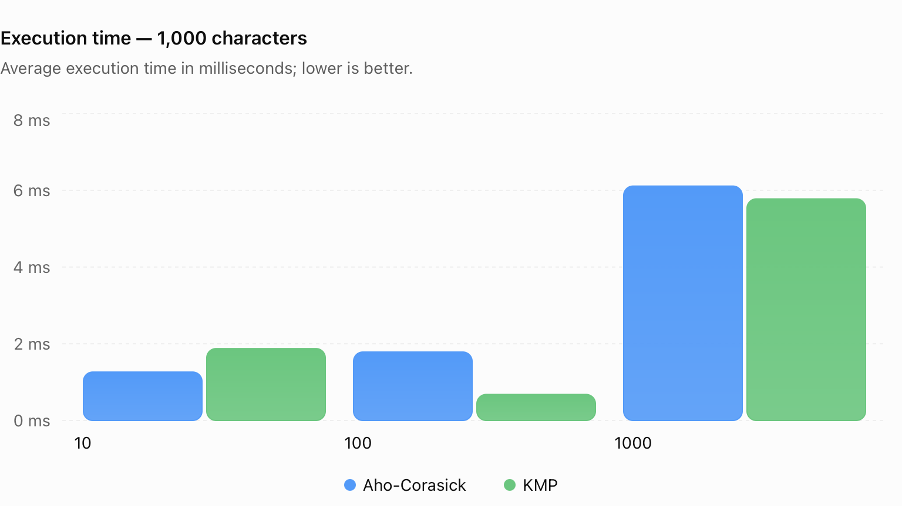
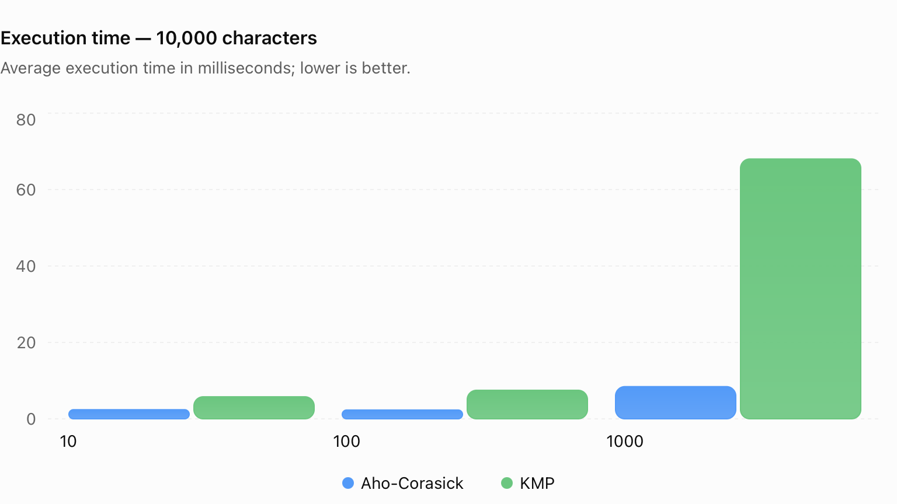
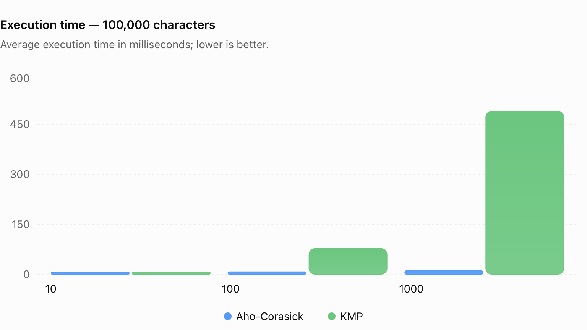

# Aho-Corasick Algorithm in Java

## 1. Project Overview

This project implements the Aho-Corasick string matching algorithm in Java. The algorithm searches for multiple patterns simultaneously in a given text.

The project also implements the Knuth-Morris-Pratt (KMP) algorithm to compare their performance.

## 2. Project Structure

```text
AhoCorasickProject/
├── src/
│   ├── AhoCorasick.java
│   ├── KMP.java
│   └── Main.java
├── results/
│   └── benchmark_results.csv
└── README.md
```

## 3. Aho-Corasick Implementation

The implementation includes four main components:

- **Trie Construction:** Stores all patterns in a prefix tree.
- **Failure Links:** Allow the algorithm to continue searching after a mismatch.
- **Output Links:** Identify additional patterns that end at the same text position.
- **Pattern Searching:** Finds all occurrences of all patterns in the text.

The algorithm scans the text in a single pass after preprocessing.

## 4. KMP Implementation

The KMP algorithm searches for one pattern at a time.

It uses the Longest Prefix Suffix (LPS) array to avoid unnecessary comparisons.

For multiple patterns, KMP must scan the text separately for each pattern.

## 5. Experimental Setup

The algorithms were tested using different numbers of patterns and text lengths.

**Number of patterns:**
- 10
- 100
- 1,000

**Text lengths:**
- 1,000 characters
- 10,000 characters
- 100,000 characters

Each experiment was performed 5 times.

Execution time was measured using `System.nanoTime()`.

The average execution time was calculated for each test case.

Both algorithms were tested using the same generated text and patterns. Some patterns were deliberately inserted into the text to guarantee successful matches.

## 6. Experimental Results

Average execution time in milliseconds:

| Patterns | Text Length | Aho-Corasick | KMP |
|---:|---:|---:|---:|
| 10 | 1,000 | 1.264 | 1.876 |
| 10 | 10,000 | 2.403 | 5.786 |
| 10 | 100,000 | 6.426 | 6.726 |
| 100 | 1,000 | 1.786 | 0.680 |
| 100 | 10,000 | 2.320 | 7.487 |
| 100 | 100,000 | 7.128 | 76.810 |
| 1,000 | 1,000 | 6.112 | 5.778 |
| 1,000 | 10,000 | 8.444 | 68.023 |
| 1,000 | 100,000 | 10.297 | 488.912 |

All experiments completed successfully, and both algorithms returned the same total number of matches in every test case.
### Performance Graphs

#### Text Length: 1,000 Characters


#### Text Length: 10,000 Characters


#### Text Length: 100,000 Characters


## 7. Complexity Analysis

Let:

- N = text length
- P = total length of all patterns
- K = number of patterns
- L = maximum pattern length
- Z = number of reported matches

### Aho-Corasick

- Trie construction: O(P) expected time.
- Failure link construction: O(P × L) conservative worst-case bound for the fallback-loop implementation.
- Searching: O(N + Z).
- Space complexity: O(P + Z), including stored results.

After preprocessing, Aho-Corasick searches all patterns in one pass through the text.

### KMP

For one pattern of length M:

- Time complexity: O(N + M).
- Space complexity: O(M + Z).

For K patterns searched separately:

- Time complexity: O(K × N + P + Z).

## 8. Performance Discussion

The experimental results show that Aho-Corasick generally performs better when searching for a large number of patterns in long texts.

For 1,000 patterns and a text length of 100,000 characters:

- Aho-Corasick: 10.297 ms.
- KMP: 488.912 ms.

Aho-Corasick was approximately 47.5 times faster in this experiment.

For smaller test cases, KMP sometimes performed better because Aho-Corasick requires additional preprocessing to construct its Trie and failure links.

The results demonstrate that Aho-Corasick is particularly suitable for searching multiple patterns simultaneously.

## 9. Advantages and Limitations

### Aho-Corasick

Advantages:
- Searches multiple patterns in one text traversal.
- Efficient for large pattern sets.
- Reports all pattern occurrences.

Limitations:
- Requires additional memory for the Trie.
- Has preprocessing overhead.
- Building the automaton can be more expensive for some pattern sets.

### KMP

Advantages:
- Simple implementation.
- Efficient for searching one pattern.
- Requires less preprocessing for individual searches.

Limitations:
- Searches only one pattern per execution.
- Repeats text scanning for multiple patterns.

## 10. Conclusion

The project demonstrates the advantages of multi-pattern string matching using the Aho-Corasick algorithm.

Experimental results show that its performance advantage becomes more significant as the number of patterns and text length increase.

KMP remains a suitable solution for individual pattern searches, while Aho-Corasick is more efficient for multiple-pattern searching.